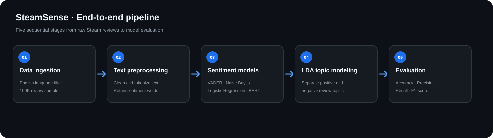
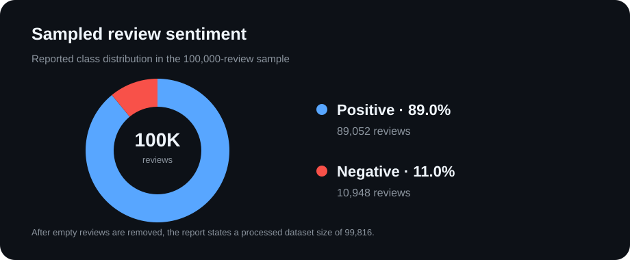
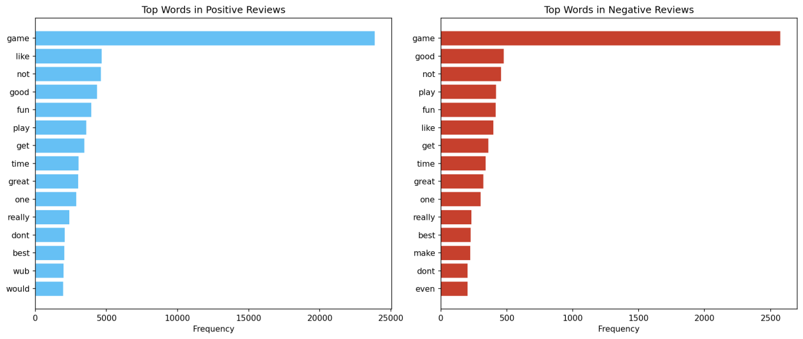
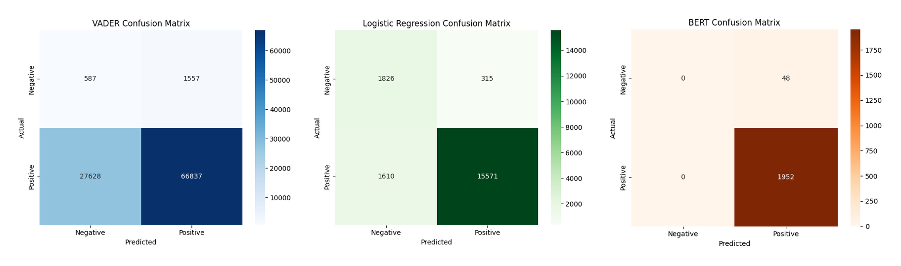
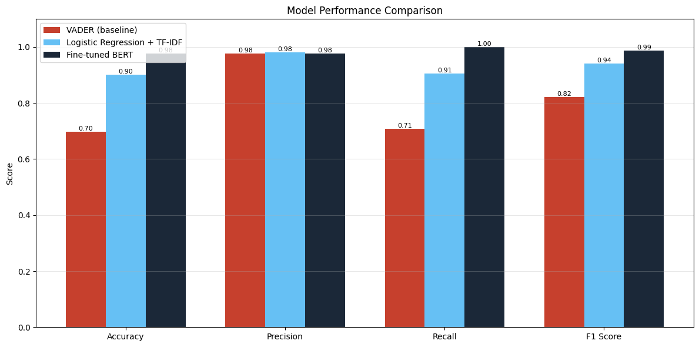

# B198c5-End-to-End-Data-Science-Project

SteamSense: AI-Powered Steam Review Analysis. An NLP-based pipeline that transforms large volumes of Steam player reviews into sentiment insights and actionable recommendations for game developers.

  

## Overview

SteamSense helps developers understand what players like and dislike without manually reading thousands of reviews. It combines sentiment classification with topic modeling to identify both overall player opinion and the reasons behind it.

## Business Value

* **Faster feedback analysis:** reduces the effort required to process large volumes of player reviews.
* **Data-driven updates:** highlights recurring complaints and positive feedback to support patch and product decisions.
* **Accessible market intelligence:** gives smaller studios a structured way to learn from player feedback.

## Dataset

The project uses the Steam Reviews 2021 dataset on Kaggle, which contains approximately 21 million reviews.

A stratified sample of 100,000 English-language reviews was selected. After empty reviews were removed, the report states that the processed dataset contained 99,816 entries.

  

## Data Pipeline

1. **Data ingestion:** English-language reviews are filtered and a random sample of 100,000 is selected.
2. **Text preprocessing:** URLs, HTML and Steam BBCode tags are removed; text is lowercased, tokenized with NLTK, filtered for stopwords, and lemmatized. Sentiment-bearing words are retained.
3. **Sentiment classification:** the pipeline compares VADER, TF-IDF-based Multinomial Naive Bayes and Logistic Regression, and fine-tuned BERT (bert-base-uncased). BERT is fine-tuned for one epoch on a stratified 10,000-review sample using a T4 GPU.
4. **Topic modeling:** separate LDA models extract themes from positive and negative reviews. Positive reviews cover gameplay, core loop, graphics and story; negative reviews focus on bugs, crashes, optimization and price.
5. **Evaluation:** models are assessed using accuracy, precision, recall and F1-score with a stratified train/test split.

## Topic Modeling Insights

The LDA analysis extracts recurring terms from positive and negative reviews, helping developers move beyond a simple positive/negative label.

  

## Model Performance

Reported results from the evaluation table:

* **VADER (baseline):** Accuracy 0.70 | Precision 0.98 | Recall 0.71 | F1-score 0.82
* **Logistic Regression + TF-IDF:** Accuracy 0.90 | Precision 0.98 | Recall 0.91 | F1-score 0.94
* **Fine-tuned BERT:** Accuracy 0.96 | Precision 0.98 | Recall 1.00 | F1-score 0.99*

  

  

